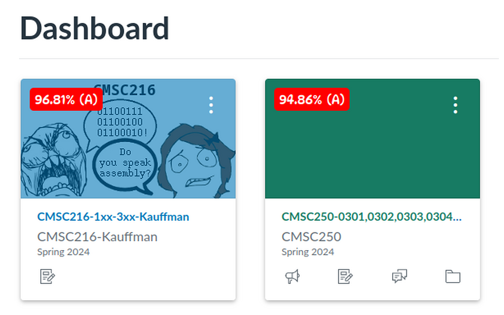
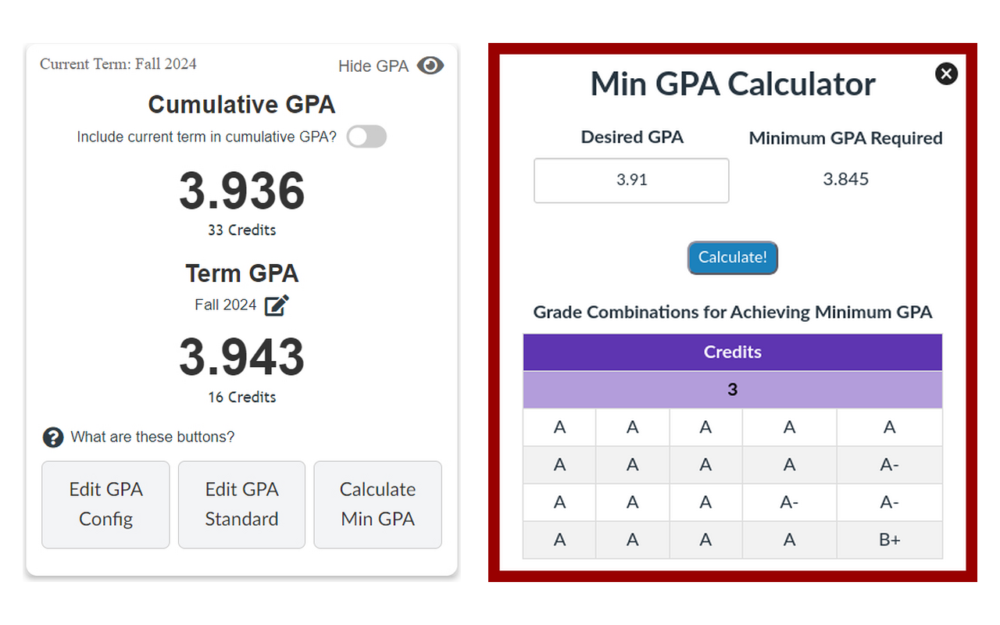
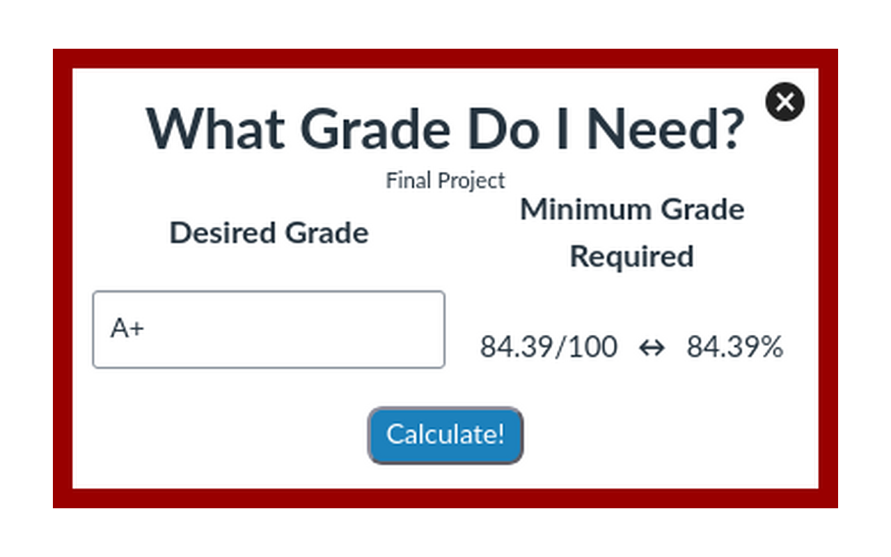
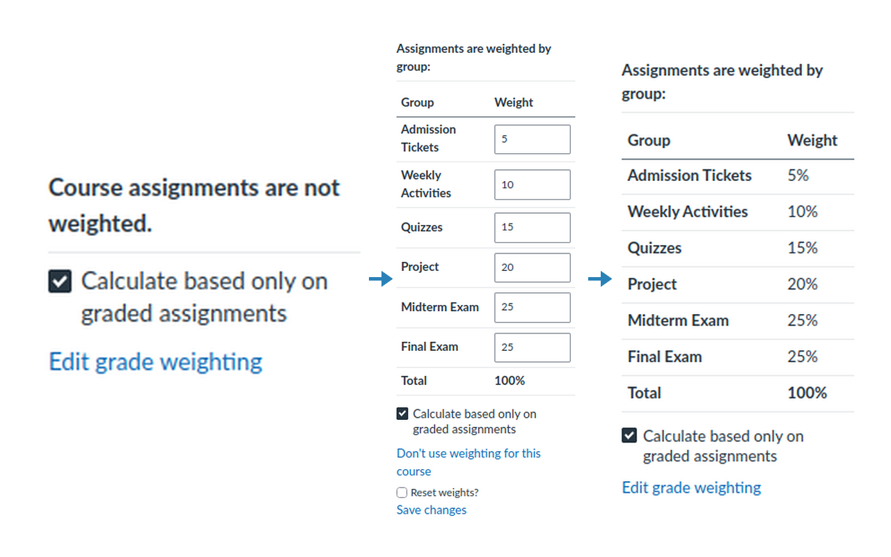
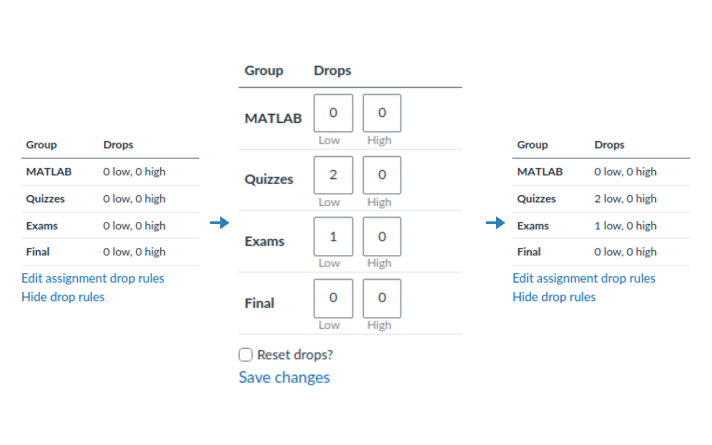

#  CanvasGradesPro

> Extension for enhancing your Canvas experience with features designed to simplify grade tracking and improve your academic performance. Dashboard grades & GPA, course page improvements, and much more!

## Install

[link-chrome]: https://chromewebstore.google.com/detail/canvasgradespro/llckodagdcbdenhnjkhkpeeeajodfldc 'Version published on Chrome Web Store'
[link-firefox]: https://addons.mozilla.org/en-US/firefox/addon/canvasgradespro/ 'Version published on Mozilla Add-ons'

[][link-chrome] [][link-chrome] and other Chromium browsers

[][link-firefox] [][link-firefox]

## Overview

CanvasGradesPro adds grade tracking and calculation tools directly to Canvas. It shows your course grades and GPA, and calculates the assignment grade or term GPA needed to reach your goal.

- Calculate your course grade when the total is hidden
- Show course grades on dashboard cards
- Add a GPA card to the dashboard
  - View your term and cumulative GPA
  - Set custom grade-to-GPA mappings
  - Find the minimum term GPA needed to reach a cumulative GPA goal
- Set custom assignment group weights
- Set custom assignment group drop rules
- Set custom letter grade ranges
- View class grade statistics
- Recalculate course grades when using Canvas "What-If Scores"
- Find the minimum assignment grade needed to reach a desired course grade
- Customize dashboard grade overlays with colors and fonts

### Dashboard Grade Overlays

### GPA Card and Minimum GPA Calculator

### Minimum Grade Calculator

### Custom Assignment Group Weighting

### Custom Assignment Group Drop Rules

## Next Steps 

I'm constantly looking to enhance this extension and would love your input! If you have suggestions for new features, please take a moment to fill out this [Google Form](https://docs.google.com/forms/d/e/1FAIpQLSdjEcsXiOFBt0HN6t7ra3wvjiaJJREMW35u_u3CsmOzR3aaKA/viewform) and vote on the features you'd like to see in the future. 
Your feedback is invaluable in making this extension even better!
  
If you have any feature suggestions or improvements that can be made to the extension, please [create an issue](https://github.com/jpatel2005/CanvasGradesPro/issues/new) so that I can hear your idea.

### Known Bugs / Issues + Things I'm Working On:
- Issues
  - N/A
- Working On:
  - N/A

## Final Notes

If you are facing any issues with the extension, please [create an issue](https://github.com/jpatel2005/CanvasGradesPro/issues/new).  
If you are enjoying your experience with CanvasGradesPro, consider ⭐ **leaving a review**  and/or **starring this repository** ⭐
